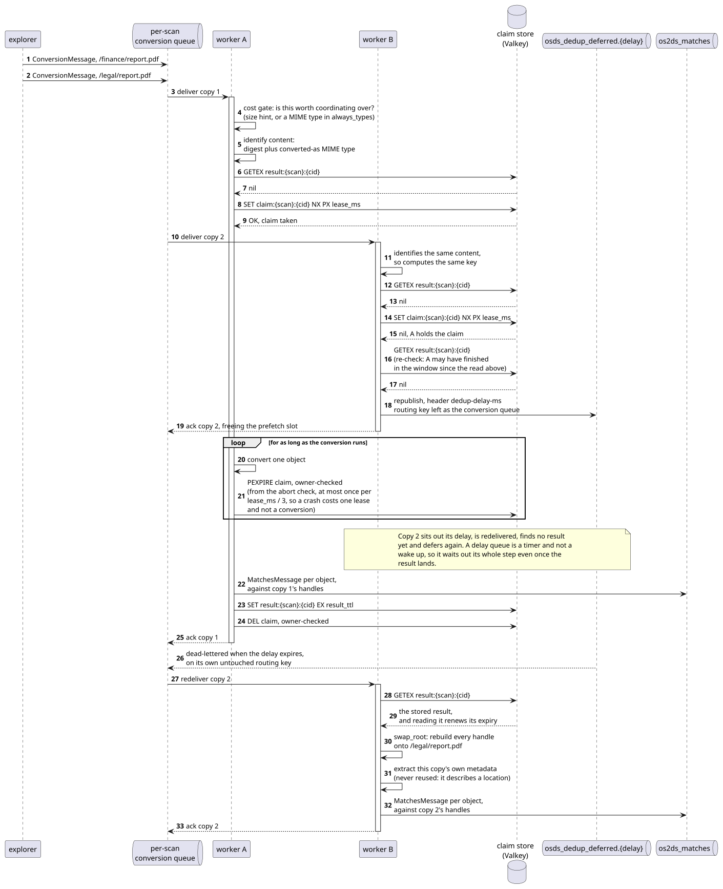

# Conversion deduplication

Converting an object is by far the most expensive thing the pipeline does: a
scanned PDF can occupy a worker for hours of OCR. The same object often turns up
in several places in one scan, the same attachment mailed to twelve people or the
same report copied into every department's folder, and by default every copy is
converted from scratch.

With deduplication enabled, workers coordinate through a shared store so that
identical content is converted once per scan instead of once per copy. The first
worker takes a *claim* on the content and converts it; the others defer and
later replay its result. **Every location is still reported.** A worker that
skips the conversion reports the first worker's findings against its own object,
and extracts that object's own metadata.

The feature is off by default. See [Settings](#settings) below. The reasoning
behind the design is in the
[decision history](../decision-history.md#conversion-deduplication).

## The keys

All keys are namespaced per scan, so nothing is reused across scans.

    claim:{scan}:{cid}    the lease held by the worker currently converting
    result:{scan}:{cid}   the finished result, for other copies to replay
    keys:{scan}           every key the scan wrote, read when clearing up

`{scan}` is the scanner's primary key and the scan's start time. An object whose
scan tag lacks either is not coordinated: a placeholder would file every such
scan under one name.

`{cid}` is built from:

| Component | Why it is in the key |
|---|---|
| Content digest | The bytes that were converted. |
| Converted-as MIME type | `Resource.compute_type()` prefers the type guessed from the object's name when the sniffed type is generic, so the same bytes as `report.doc` and as `report` go to different converters. |
| Progress fragment fingerprint | One scan can ask different questions of identical bytes reached by different routes. See below. |

Take a rule of `AndRule(EmailHeaderRule("subject"), CPRRule())` and one document
that sits both on a file share and attached to a mail:

| | remaining rule | accumulated matches |
|---|---|---|
| the file on the share | the whole tree | none |
| the same bytes, attached | `CPRRule` alone | the email header's finding |

The matcher copies accumulated findings into the message it emits, so sharing
between these two would report an email-header finding against a file share, or
lose it from the attachment. Both halves of the progress fragment are therefore
in the key.

Matches from synthetic rules are left out of the fingerprint. Every incremental
scan starts with a `LastModifiedRule`, which concludes with the object's own
modification time and passes that down to everything inside it; keeping it would
stop the same attachment in two mails from ever sharing. Synthetic matches are
not stored in a result either, so nothing replayed depends on them.

The fingerprint is canonicalised by sorting every list at every depth
(`deduplication.progress_fingerprint`). `CPRRule` joins its exception lists into
strings, which sorting cannot see into, so it sorts them itself in
`to_json_object`. `test_set_derived_list_order_cannot_affect_the_key` and
`test_cprrule_new.py` hold both in place. See the
[decision history](../decision-history.md#the-content-key-is-canonicalised-by-its-consumer).

## Which stage decides

The **processor** decides, between following an object's Handle and converting
it (`deduplication.plan_conversion`). It is the one stage that sees both
top-level objects and objects found inside containers. The **worker** acts on the
decision:

| Outcome | What the processor does | What the worker does |
|---|---|---|
| `None` | converts | nothing special |
| `Claimed` | reports the claim, then converts | holds the lease, captures what the conversion produces, publishes it (`sharing.share`) |
| `Stored` | converts nothing | replays the stored result against this object (`sharing.replay`) |
| `Contended` | converts nothing | waits: see [Deferral](#deferral) |

These outcomes are not pipeline messages and never reach a queue, so the
processor only coordinates when its caller passes `coordinate=True`, which only
the worker does. `Claimed` is yielded before the conversion starts, so the lease
covers the whole of it.

## What a worker does with an object

| Rule shareable | Store | Stored result | Claim | Outcome |
|---|---|---|---|---|
| no | | | | convert, uncoordinated; the content is never read to hash it |
| yes | off, or content unidentifiable | | | convert, uncoordinated |
| yes | unreachable | miss | failed, read as won | convert; publishing fails too |
| yes | available | a real result | | **replay** it against this copy |
| yes | available | "unshareable" marker | | convert, do not claim |
| yes | available | none | won | **convert and publish** the result |
| yes | available | none | lost | **stand down**; convert anyway once `max_deferral_ms` is spent ([inside a container](#content-inside-a-container): at its second look) |

Two orderings matter:

* The rule is checked **before** the content is read. Every incremental scan asks
  a `LastModifiedRule` first, and reading every object in full to answer that
  would defeat the point of a delta scan. Only that request is uncoordinated: once
  the matcher has resolved the `LastModifiedRule`, the follow-up request for
  content is coordinated like any other.
* The stored result is read **before** the claim is attempted, because the
  finishing worker deletes its claim: claiming first would take an uncontended
  claim on content whose result is already waiting. After a lost claim the result
  is read once more, as the holder may have finished in between.

The same decisions, for two copies of one document. A third copy behaves like
the second.

The lease is renewed from the conversion's abort check (`worker.make_checkpoint`),
throttled to once per third of `lease_ms`. That lets it be far shorter than the
conversion, though not shorter than the longest stretch that reaches no abort
check: see `lease_ms` under [Settings](#settings).

### When a result may be shared

`Rule.flatten()` reduces the rule to its leaves, and every leaf's `operates_on`
must be in `CONTENT_DERIVED_OUTPUT_TYPES`. The check is on the output type, not
the rule type: a new rule operating on `Text` is shareable without further work.
`OutputType.Size`, a missing `operates_on` or a rule that cannot be flattened
counts as unshareable. A fully resolved rule (`True`/`False`) counts as
shareable.

Two types in the set are not derived from the content alone. `Links` resolves
relative links against the object's own location, and `EmailHeaders` on an
object inside a mail reads the enclosing mail's headers. A result involving
either can therefore be replayed against a copy it does not hold true for.

### Replaying a result against another copy

Two copies of the same content have structurally identical Handle trees beneath
them: page 5 of a PDF is page 5 wherever that PDF lives. `swap_root` replaces
only the root, through `Handle.remap`.

Metadata and the scan specification are not reused: they describe a location,
so the replaying worker supplies its own and runs the tagger as usual.

A worker that converts but cannot offer its result (the conversion produced a
problem or content-missing message, produced no results, or the result could not
be encoded) stores an "unshareable" marker instead, so the other copies convert
now rather than deferring until `max_deferral_ms` runs out.

## Deferral

A worker that loses a claim must not block for a conversion that can run for
hours. It republishes the message to a delay queue that dead-letters it back to
the conversion queue it came from, and acks the original delivery
(`pipeline/utilities/deferral.py`):

    worker → osds_dedup_deferral → osds_dedup_deferred.60000
           → the default exchange → osds_conversions.{pk}_{time} → worker

The topology:

- **Nothing consumes the delay queues.** One set serves every scan, because the
  return hop routes on the message's own routing key.
- **One queue per delay, not a per-message expiry.** A classic queue only expires
  the message at its head, so mixed TTLs would release out of order. The delay is
  in the queue name because re-declaring a queue with a different TTL closes the
  channel; changing `backoff_ms` brings new queues into use instead.
- **Routing in is by header.** The `dedup-delay-ms` header picks the delay queue
  on the `headers` exchange, leaving the routing key untouched for the return hop.
- **Everything on the route is durable.** A deferred message has already been
  acked from its original queue, so losing it would lose the object for the
  whole scan.

The bookkeeping (attempts and total time waited) travels in the message body
under `dedup_deferral`, because a stage handler cannot see AMQP headers. A
deferred object emits no status message, so it is not counted twice.

Deferral is bounded by `max_deferral_ms`, after which the copy converts anyway.
That covers a claim that vanished without a result, through eviction or a store
restart. An empty `backoff_ms` disables deferral altogether.

## Content inside a container

An attachment on a mail or a member of an archive is walked within the delivery
of its container (`worker.explore`), and each one passes through the processor,
so it is coordinated exactly like a top-level object.

It cannot be deferred, though: the container's delivery cannot be half acked. On
`Contended`, `explore()` **sets it aside** and carries on with the rest of the
container. At the end of the walk, `second_look()` runs the protocol again:
replay if the result has arrived, convert if the claim has been released, and
convert a duplicate if it is still contended. `deduplication.settled()` makes
sure no object is set aside twice, so nothing goes unscanned.

- **An archive of many documents**: the wait is the rest of the walk, which is
  where duplication between consecutive backups pays off.
- **A mail with one attachment**: setting aside gains nothing, but a mail scanned
  after the attachment's result is stored still replays it.

### Every held claim is renewed

A coordinated object can contain coordinated objects, so a worker can hold
several claims at once. `renew_claims()` renews all of them; otherwise an outer
claim would expire during a nested conversion and another worker would convert
the same content in parallel.

## Cost gate

Coordinating costs a full read of the object to hash it, plus store round trips.
`plan_conversion` runs its checks cheapest first:

1. **Not already decided on** (`settled`).
2. **Type or size.** The type guessed from the name is in `always_types`, or
   the size hint is at least `min_size`. An object with no size hint qualifies
   only on `always_types`. Nothing is read.
3. **Not skipped.** The guessed type is not in the scan's `skip_mime_types`
   (`image/*` when OCR is off).
4. **Rule shareable.** See [above](#when-a-result-may-be-shared).
5. **Something to convert.** The type the content will be converted as
   (`Resource.compute_type`; a file sniffs its first 512 bytes) has a
   converter or is a container (`can_convert`). Video, audio, unknown binaries,
   and images with no OCR registered fail here. Archives and Office documents
   pass as containers: replaying one skips walking everything inside it.
6. **Identify.** `compute_content_identifier`, once, within
   `identify_timeout`. A `FileResource` hashes the whole object; a mail from a
   mail account reads its Message-ID. A Resource that returns no identifier is
   converted uncoordinated.

`default-settings.toml` explains the shipped `min_size` and `always_types`.

### Mail

Each MIME part a `MailSource` yields carries a size hint and its declared type,
and `MailPartResource` hashes the decoded payload, so parts are identical across
recipients however much the envelopes differ:

- **An attachment** qualifies on size.
- **An inline image** qualifies as `image/*` (`TestASignatureImageInTwoMails`).
- **A small body part** falls under `min_size` and is converted uncoordinated.

A mail from a mail account is identified by its
[Message-ID](../decision-history.md#mail-is-identified-by-message-id). Gmail
handles carry `sizeEstimate`, so Gmail mails over `min_size` are coordinated and
one mail delivered to many mailboxes is converted once. EWS and MSGraph handles
carry no size hint and `message/rfc822` is not in `always_types`, so those mails
are not coordinated.

A `.eml` on a file share is an ordinary file and is coordinated like one.

## When the store misbehaves

- **Every operation fails open.** An unreachable store costs performance, never
  correctness; a failed read is a miss and a failed claim reads as won.
- **There is no stand-down.** Each call pays its own `socket_timeout`, in
  exchange for picking the store back up as soon as it returns. Objects that
  clear the gate are still read and hashed first.
- **An unreadable result is a miss.** It is decoded in full before anything is
  emitted, and the copy converts instead.
- **Losing a key is safe**: the content is converted again. Eviction can stay on,
  but run the store with `appendonly yes` so a restart does not drop every
  running scan's results.

## What the store holds, and protecting it

A stored result is the root handle, one handle per result and the match
fragments, as JSON, gzipped when that is smaller (`deduplication.encode_result`,
`_pack`). That is the same material a `DocumentReport` is built from, and it
needs the same care:

* **Handles** are censored, as on the way to the report module, so no Source
  credentials are stored. Paths, share names and URLs remain, and those
  routinely contain personal names.
* **Rules** are stored once each under `rules`, and fragments refer to them by
  index. A `CPRRule`'s `exceptions` are real CPR numbers.
* **Match fragments** include `context`, fifty characters of raw document text
  either side of each match, and `RegexRule` matches are stored verbatim.
  Synthetic fragments are dropped.
* Metadata and the scan specification are not stored. Every key carries the
  scanner's primary key, and censored mail handles still name the account
  (Gmail address, EWS user and domain, MSGraph tenant).

What follows from that:

* Put the store where the report database would go, reachable by the workers
  only.
* Set `username`/`password`, through the environment
  (`pipeline__worker__dedup__password`) rather than a settings file.
* There is no TLS and no payload encryption. Results cross the network in clear
  text.
* A persistent store writes match contexts to disk; protect that disk like the
  report database's.
* When a scan finishes or is cancelled, the admin module broadcasts
  `clear_dedup_store` and every worker deletes the scan's keys via its `keys:`
  index. `result_ttl` is the backstop for scans nobody declared finished; reading
  a result renews it. Leftover keys can be removed sooner with
  [`cleanup_dedup_store`](../management-commands.md#cleanup_dedup_store).
* The dev store listens on `127.0.0.1:8036` with `osds`/`osds`. Fine for a laptop,
  not for anything else.
* Size the store against the qualifying objects of the scans running at once. An
  ordinary result measured about 0.8 kB in memory. A container's result holds
  every member's handles and matches, so it grows with the container (a nested
  object is stored both under its own key and inside its container's). Leave
  headroom above `maxmemory` for the append-only rewrite fork.

## Settings

All under `[pipeline.worker.dedup]`. See
`src/os2datascanner/engine2/default-settings.toml` for the shipped values.

| Setting | Meaning |
|---|---|
| `enabled` | Master switch. Off by default. |
| `host`, `port`, `db`, `socket_timeout` | The shared store (Valkey or Redis). An empty `host` disables coordination however `enabled` is set. |
| `username`, `password` | Store credentials. Empty means no authentication. Prefer the environment (`pipeline__worker__dedup__password`). |
| `min_size` | Objects smaller than this are never coordinated. |
| `identify_timeout` | Seconds a worker may spend hashing one object. Attempted once. |
| `always_types` | MIME types coordinated whatever their size. A trailing wildcard matches a family. |
| `lease_ms` | How long a claim stays valid without renewal. |
| `result_ttl` | How long a result may go *unused* before it is discarded. |
| `backoff_ms` | Delay per deferral, indexed by attempt. The final value repeats. Empty disables deferral. |
| `max_deferral_ms` | Total time a copy may spend deferred before converting itself. |

Two settings silently defeat the feature if set too low:

* `max_deferral_ms` must exceed the longest conversion worth deduplicating, or
  copies give up and every copy pays in full.
* `lease_ms` must exceed the longest stretch of a conversion that reaches no
  abort check: PDF pre-processing, bounded by `pdf_clean_timeout`. A shorter lease
  expires under its holder and the content is converted twice, unreported.
  `_check_lease_ms` takes the floor as `pdf_clean_timeout` plus `op_timeout` ×
  `op_tries`, and warns at startup when the lease is below it.

`enabled` is independent of `CHECK_DUPLICATION`, which governs duplication
statistics; see the
[decision history](../decision-history.md#duplication-statistics-are-reported-separately).
